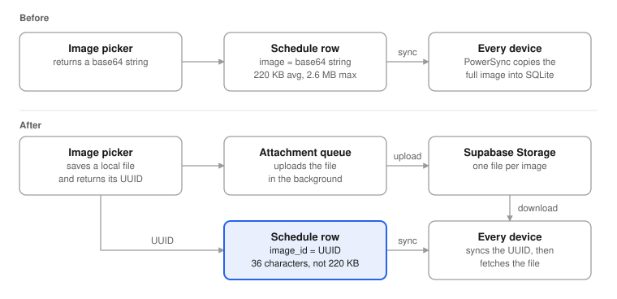

this is a write-up of a fix i designed and shipped at folderly in january 2026. i didn't build the first version of the feature, a teammate did. i built what replaced it, and a few days later i tracked down a retry loop in the image queue that it now runs on.

quick context first. folderly is a planner app i co-founded, it's at 1M+ users now. the current app is react native + expo, all typescript. every device keeps a local sqlite copy of the user's data, synced from supabase postgres through powersync.

that last part matters for this whole post. in a sync-first app, whatever you put in a row doesn't stay on the server. it gets copied to every device the user has.

## the first version put images in the row

the schedule screen shows your current class as an ipod-style card with a cover image. in the first version, built in early january, the image picker took the photo, turned it into a base64 string, and saved it straight into the `image` column of `folderly_schedules`.

it worked. it also meant every schedule photo got copied along with every sync.

by the time i looked at it, the numbers were rough:

- the schedules table was 641 MB
- 629 MB of that (97%) was base64 image data
- images averaged 220 KB, and the biggest was 2.6 MB

honestly, folderly already had the right tool for this. user cards and course images went through an attachment queue backed by supabase storage. schedules were the one place still storing images in the row.

## what i changed



the idea fits in one line: keep the image as a file in storage, and keep only its id in the row. a UUID is 36 characters. the average image was 220 KB.

it shipped as one typescript PR, about 380 added lines. most of the thinking went into four small interface decisions.

### one hook decides where an image comes from

screens call `useScheduleImageUri(schedule)` and get back a URI or nothing. storage first, old base64 second:

```ts
export function useScheduleImageUri(
  schedule: Schedule | null,
): string | undefined {
  const { imageUri } = useAttachmentUrl(schedule?.imageId ?? null);
  if (imageUri) return imageUri;
  if (schedule?.image) return `data:image/jpeg;base64,${schedule.image}`;
  return undefined;
}
```

that fallback is what kept old and new rows looking the same while the rollout was in progress. a row nobody had migrated yet still showed its photo.

### the preview component doesn't know where images live

`IPodPreview` used to take a raw base64 prop and build the data URI itself. i changed the prop to `imageUri`. now the schedule screen passes whatever the hook resolves, the edit form passes the local file you just picked, and the component doesn't care which one it got.

### setting an `image_id` wipes the old base64

in `updateSchedule`, writing `imageId` also writes `image = NULL`, unless the caller set `image` itself. so a row can't hold both, and the moment a user picks a new photo, the blob stops syncing.

### the form doesn't wait for the upload

picking an image saves it into the attachment queue and hands back its UUID. the form shows the local copy right away and the queue uploads it in the background. if the upload is slow or the phone is offline, the schedule still saves.

## moving the old images

new images were sorted. the 641 MB already sitting in the table wasn't.

my first attempt ran the migration on the device. on connect, the app looked for rows with base64 and no `image_id`, pushed each one through the queue, and set a "done" flag. i replaced it the same day, because reading it back, it was wrong in three ways:

- it ran once per device, not once per row. someone with a phone and a tablet could migrate the same row twice before either write synced, and one of those uploads ends up orphaned.
- anyone who never opened the new version kept their base64 forever, so the table would never fully shrink.
- a failed row still counted toward the total, and the done flag got set anyway. with enough failures at the front of the queue, some rows never even got tried.

so it became a one-off server-side script that runs against supabase with the service role key, 10 rows at a time with a 500 ms pause. before pointing it at production data i added:

- pre-flight checks for the connection, the new column, and the storage bucket
- a `--dry-run` mode that reports what would move and how big each image is
- one row update that sets `image_id` and clears `image` together, only after the upload succeeds, so a failed row keeps its base64 for the next run
- deleting the uploaded file if that row update fails, so a failure doesn't leave an orphan behind
- `upsert: false` on upload, so a UUID collision fails loudly instead of overwriting someone else's image
- it only picks rows that still have no `image_id`, so you can stop it halfway and rerun it safely
- progress, rate, and a list of failed IDs in the output

the rollout order was written into the PR: add the column, deploy the powersync sync rules, run the script, confirm zero rows are left, run `VACUUM FULL` to get the space back, and only then ship the app update.

## then the image queue got stuck in a retry loop

a few days later, in early february, supabase storage was getting thousands of failed requests an hour, all 400s. i traced them to the attachment queue, the same one every folderly image goes through now, schedules included. a teammate built the queue and its error handling. i found the cause and wrote the fix.

users saw nothing, which is what made it bad. each user with an image reference whose file was missing from storage caused about 240 failed requests an hour, so the number grew with every active user.

two bugs fed each other:

1. the download error handler searched `error.toString()` for the text `"status":400`. supabase's `StorageApiError` only prints its class name and message, so the status never showed up, and every 400 and 404 got retried like a temporary network error.
2. even when a download was marked as not retryable, it came back. the queue's base class only watches records in states below `ARCHIVED`, so an archived record looked brand new to the watcher, which reset it to `QUEUED_SYNC`.

put together: every 30 seconds, for every user and every missing image, the queue tried a `.jpg`, then a `.png`, failed both, and queued itself again.

the fix reads `error.status` directly instead of parsing a string. a download that fails for good gets marked `SYNCED` with an empty placeholder file, not `ARCHIVED`. the watcher does see `SYNCED` records, and it skips any whose local file exists, so the loop stops there.

## where it is now

the PR merged on january 29, 2026. as of september, the hook, the `image_id` column, and the queue's schedule watcher are still the only path for schedule images, and the hook hasn't changed since it landed.

the PR projected the table going from 641 MB to about 20 MB once the script and `VACUUM FULL` had run.

one step is still open: drop the `image` column, delete the base64 fallback, and retire the script. i held that back for a separate PR once the rollout was stable.

## what i took from it

in a sync-first app, every column you add is something every device downloads. a photo in a row looks harmless on one phone. across every user, it added up to 629 MB of base64 in one table.

and the bugs that cost the most here were the quiet ones. nobody saw a broken image. the only signal was the request count on storage.
