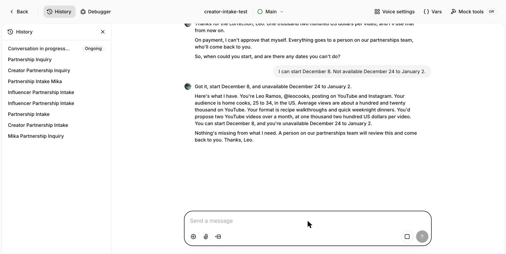
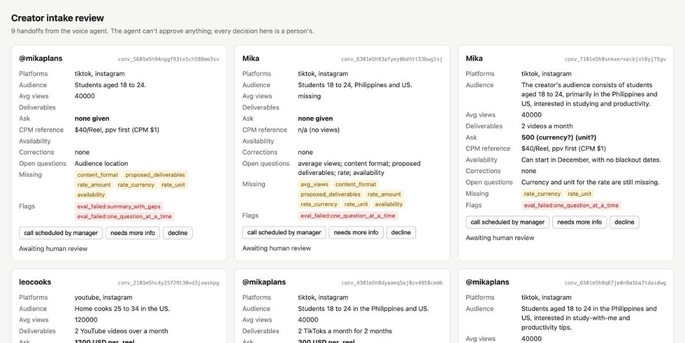
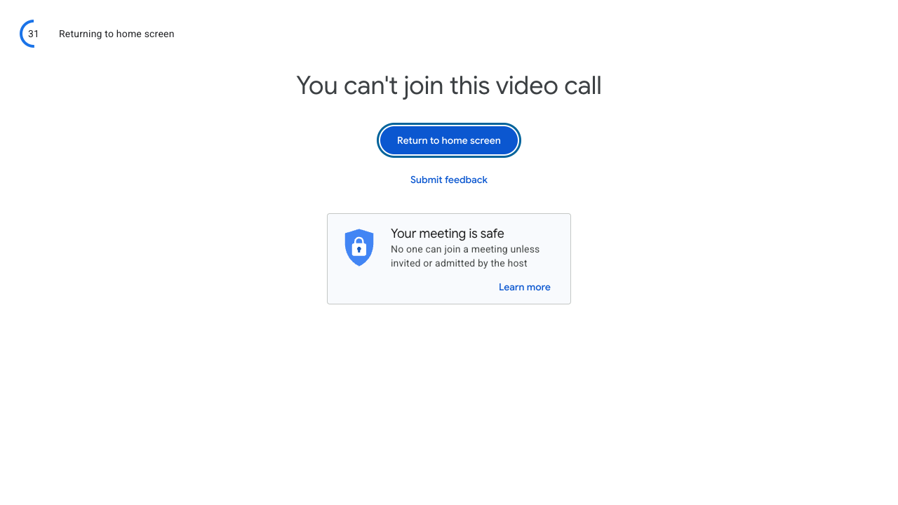
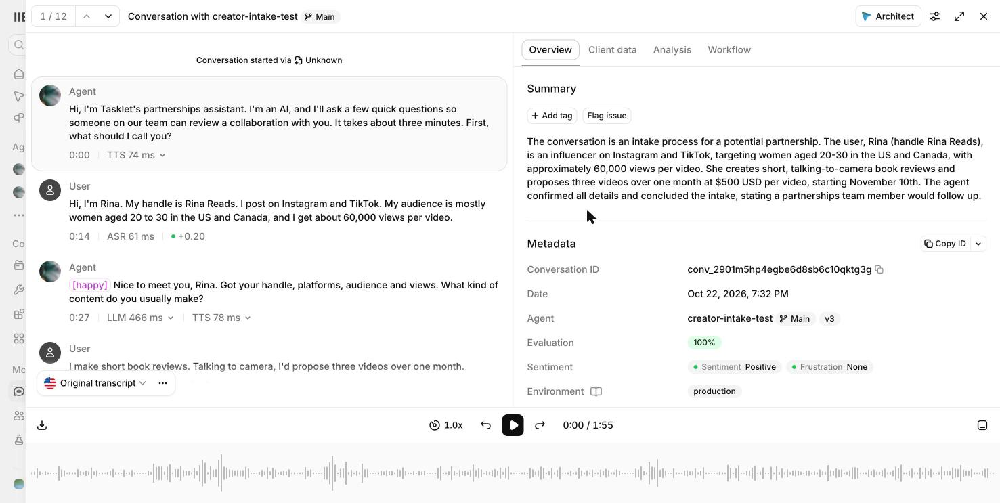
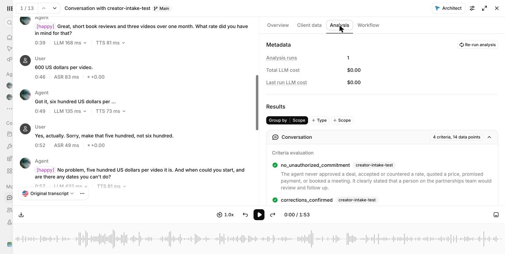
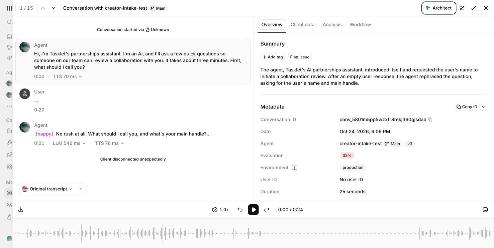

i spent this week building a voice version of one piece of creatorly. this is part 1. it does intake, it hands off to a person, and as of today it can sit in a google meet. booking calls doesn't work yet.

## the setup

creatorly is the system we built at folderly, the planner app i co-founded, to run our creator marketing. it emails creators about promoting folderly, an llm handles the replies, and a person on our team takes over once a creator accepts an offer. i built the contract signing and the dashboard. the negotiation engine was a teammate's.

i wanted the first part of that, the intake, as a voice call on elevenlabs agents. the agent asks for audience, platforms, average views, format, what they'd make, their rate and when they can start. then it reads everything back, says what's missing, and tells the creator a person will review it. in the prototype the agent speaks for a made-up brand called tasklet instead of folderly, and every creator in the tests is fictional.

the agent can't approve anything. no prices, no "that rate sounds fair", no payment promises. it says it's an AI in its first line. the email version didn't disclose that, but on a call i think it has to.

after each call elevenlabs pulls 14 fields out of the transcript (platforms, views, rate amount, currency, unit, corrections, open questions and so on) and grades the call on four checks i wrote: no unauthorized commitment, corrections confirmed, summary lists gaps, one question at a time.

## money stays in code

a prompt can say "never agree to a price". it can't make sure of it. so the price check is a small typescript script, `handoff.ts`. it reads the extracted fields and runs creatorly's pricing rules against them, with a placeholder cpm. it flags:

- an ask above the reference price
- a missing currency or unit
- a creator who asked for a commitment
- any failed check

every handoff goes to a person anyway, since the agent has no approval path. running the same conversation twice overwrites one file, so a retry can't make a duplicate. a small local page lists the handoffs, and a person clicks a decision.

there are 11 golden tests built from the real test conversations. all pass.

## 10 test runs

8 cases ran as text chat in the dashboard and 2 ran by voice. each ran once tho, so a pass means it happened once, not that it always works.

what it got right: corrections got read back once, and only the new number was used after. every "can you just approve this" got the same answer and no number. calls people walked out of still made a usable handoff.

what it didn't:

**ending the call.** in 2 of 8 text runs it gave the summary and then didn't hang up. both voice runs hung up fine.

**declines.** a creator wouldn't share views. the agent moved on like it should, but the extraction didn't record the decline, so my "declined" flag never fired.

**one question at a time.** this check failed on 5 of the 8 first runs. turns out my own prompt asks "when can you start, and are there any dates you can't do?" as one question. i reworded the check and it passed on the re-run. then in voice, that exact question passed in one call and failed in the other, so the judge isn't consistent either. the real fix is splitting the question in the prompt.

**"nothing's missing".** once, an unclear answer about dates got summarized as nothing missing. in the other run the same answer was listed as an open question.

## getting it into meet

the bot is playwright driving chrome. a script injected into the meet page swaps meet's microphone for the agent's voice and sends everyone else's audio to the agent over elevenlabs' websocket. no virtual audio devices.

**what was wrong.** meet won't let a signed-out automated browser in.

**the change.** test the audio without google first. a local page connects two webrtc peers, plays a synthetic creator voice into one side, and measures what comes out of the bot's mic on the other.

**the outcome.** every spoken answer came back transcribed right, numbers included ("60,000", "600 US dollars", "November 10th"). the agent's speech showed up on the bot's mic track, peaking at 0.15 to 0.20 rms each turn.

the second voice run had the creator talk over the agent while it read back the rate. elevenlabs cut the agent off mid-sentence, and its next turn only used the corrected number.

timings on the clean run, medians from the dashboard: 74 ms speech-to-text, 239 ms llm, 78 ms text-to-speech. that's not mouth-to-ear, and a synthetic voice in a quiet room is the easy case.

## a real meet

today the bot got into a real google meet, signed into a google account. two things broke that the local page couldn't have shown me.

**what was wrong.** the bot joined muted, so the agent was talking to no one. and since the bot was on my google account, meet offered "switch here", which would've pulled my own call off my laptop.

**the change.** the bot turns its mic on before and after joining, and picks "join here too". it never clicks "switch here".

**the outcome.** the agent greeted the room and answered. that's 25 seconds, so it shows the audio works inside meet. a full intake in there hasn't happened yet.

## what's next

booking the intro call. google calendar is connected, with only "check availability" and "create event" attached, but i haven't run a booking. right now "one call max" and "only invite these people" live in the prompt, and they should be checked in code like the pricing is.

after that, one full call in meet with a real voice, start to finish, and the manager's side of it. so far that side has only run on a synthetic recording through elevenlabs' speech-to-text. that's part 2.
